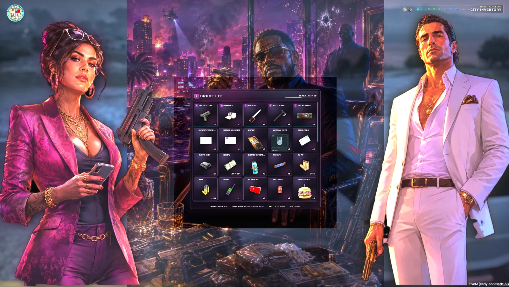
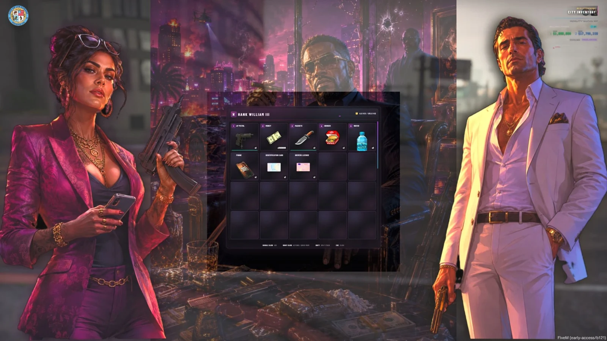
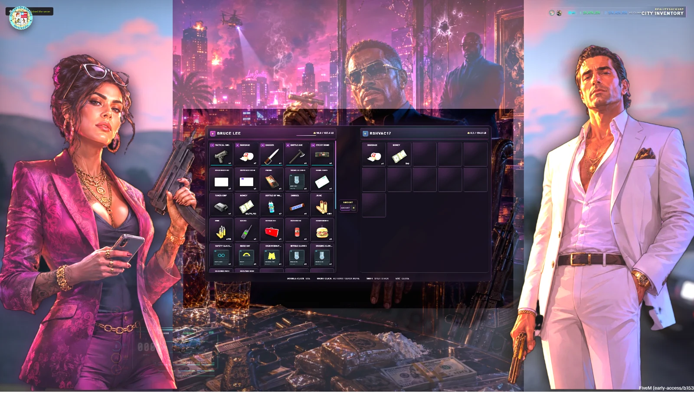

# ox_inventory — Miami Edition

<a href="https://reality-sucks-rp-webstore.tebex.io/package/7657131"></a>

Give ox_inventory a Miami identity with custom character artwork, atmospheric backgrounds and larger readable slots. Detailed item metadata, weapon attachment inspection, durability and cleaner secondary containers sit on the ox_inventory foundation, with modern Qbox setups in mind.

[Download the original ZIP](https://github.com/RealitySucksRP/ox_inventory-Reworked-Miami-Edition/releases/latest/download/ox_inventory.zip) | [Free on Tebex](https://reality-sucks-rp-webstore.tebex.io/package/7657131) | [Website](https://realitysucksrp.github.io/) | [Discord](https://discord.gg/e9V3rPHySx) | [YouTube](https://www.youtube.com/@RealitySucksRP) | [All free scripts](https://reality-sucks-rp-webstore.tebex.io/category/free-scripts)

**Install folder:** `ox_inventory`. Download the original ZIP to retain the package folder layout. Source, configuration, licenses and included assets are provided below.

<details>
<summary>More screenshots</summary>





</details>

## Package documentation

# RealitySucksRP Miami Edition

This is a modified distribution of `ox_inventory` 2.47.9 by Overextended.
RealitySucksRP modified it on 2026-08-24 and distributes the complete source
under GPL-3.0.

## What changed

- Miami-inspired cinematic inventory interface with responsive single- and dual-pane layouts.
- Local, offline-safe NUI dependencies; no remote UI code or CDN is required at runtime.
- ox-to-UI protocol adapter for drag and drop, quick move, shops, stashes, trunks, gloveboxes, drops, hotbar, notifications, and metadata.
- Detailed hover cards with escaped metadata, descriptions, item weight, durability, ammo, and named attachments.
- Weapon Inspection panel with serial, condition, tint, attachment types, installed attachment names, and click-to-detach support.
- Resilient component removal when weapon metadata and the ped component state fall out of sync.
- Expanded server item catalogue, physical vehicle-key items, cash-as-item support, and corrected shop medical stock.
## Weapon Attachment Compatibility

## ox_inventory Weapon Attachment Compatibility

When using `ox_inventory`, weapon attachments stored inside:

```lua
metadata.components
```

must be valid ox_inventory attachment items that define a `client.component` value.

Examples of valid ox_inventory attachment items may include:

```lua
at_flashlight
at_suppressor_heavy
at_clip_extended_pistol
```

Ordinary attachment item names such as:

```lua
pistol_flashlight
pistol_suppressor
pistol_extendedclip
```

should not be placed directly into `metadata.components` unless those items contain a valid ox_inventory `client.component` definition.

RS Weapon Shops validates attachment metadata before sending it to ox_inventory. Attachments that are not valid ox_inventory component items are handled through the resource's native weapon-component fallback instead.

This prevents weapon draw errors such as:

```text
@ox_inventory/modules/weapon/client.lua:
attempt to get length of a nil value (local 'components')
```

### Existing Weapons

If a weapon was purchased before this compatibility fix, it may already contain invalid component metadata.

The included ox_inventory compatibility guard safely ignores malformed component entries when the weapon is equipped, allowing the RS native component system to apply supported attachments without crashing the weapon draw callback.

This note only applies to servers using `ox_inventory`.

Weapon attachment handling differs by inventory provider.

### QBCore / qb-inventory

QBCore and qb-inventory may store and apply weapon attachments using their own weapon metadata and attachment systems. Attachment item names such as `pistol_suppressor` or `pistol_flashlight` may work normally without requiring ox_inventory-specific component definitions.

### Qbox / ox_inventory

When using `ox_inventory`, entries stored inside:

```lua
metadata.components
```

must be valid ox_inventory attachment items that define a `client.component` value.

For example, ox_inventory commonly uses attachment item names such as:

```lua
at_flashlight
at_suppressor_heavy
at_clip_extended_pistol
```

Do not place ordinary attachment items into `metadata.components` unless they contain a valid ox_inventory `client.component` definition.

RS Weapon Shops automatically validates this when creating weapon metadata. Attachments that are not valid ox_inventory component items are handled through the resource's native component fallback instead.

This prevents errors such as:

```text
@ox_inventory/modules/weapon/client.lua:
attempt to get length of a nil value (local 'components')
```

### Important

This difference is inventory-specific, not a Qbox-versus-QBCore weapon limitation.

A weapon configuration that works correctly with qb-inventory may require different attachment metadata when the same resource is used with ox_inventory.

## Framework support

The included bridges support Qbox/QBX (`qbx_core`), ESX, ox_core, and ND_Core.
QBCore and standalone bridges are not included in this archive. The Qbox bridge
requires `qbx_core` 1.18.1+ and `qbx_vehicles` 1.2.0+ as enforced by the resource.

The `rs-miami.8-qbx-production-guard` pass is specifically verified around the
Qbox path while preserving the included upstream bridge behavior for ESX,
ox_core, and ND_Core. Qbox vehicle inventory sizing uses the Qbox server
`GetVehicleClass(hash)` resolver; other included frameworks retain the upstream
client class fallback when no equivalent server resolver is available.

### Production guard behavior

- Inventory mutations continuously recheck session identity, permissions, routing
  bucket/instance, physical access and vehicle lock state where applicable.
- Database read failures fail closed. Failed database-backed player inventory
  writes remain dirty, and failed logout saves are retained in memory by stable
  character id for retry/reconnect recovery. The recovery journal is intentionally
  in-memory, so a simultaneous database outage plus full server/process crash
  remains outside its protection boundary.
- Confiscation/return is a durable database move: the recovery snapshot and player
  inventory update commit atomically, restore merges with items gained afterward,
  and the recovery row is preserved on decode, capacity, weight, or database failure.
- Player teardown waits for active inventory slot transactions before its final
  save/remove, preventing disconnects from snapshotting a half-completed mutation.
- Crafting and shop transactions are slot-locked and rollback protected. Crafting
  completion is also checked against server elapsed time instead of trusting the
  NUI progress callback alone.
- Floor drops are bucket/instance aware for current players and late joiners.
- No external `rs_bridge` dependency is required or added.

## Requirements

- FiveM server artifact 6116 or newer (your selected framework may require a newer artifact)
- OneSync
- oxmysql
- ox_lib
- One of the supported frameworks above
- For Qbox: `qbx_core` 1.18.1+ and `qbx_vehicles` 1.2.0+

Set the framework and inventory options through the normal `inventory:*` convars.
The resource folder must remain named `ox_inventory`.

### Qbox server.cfg minimum

Place the framework convar before the framework/inventory resources start:

```cfg
setr inventory:framework "qbx"
set inventory:accounts ["money"]

ensure oxmysql
ensure ox_lib
ensure qbx_core
ensure qbx_vehicles
ensure ox_inventory
```

If your Qbox build requires a newer FiveM artifact than this resource's generic
minimum, Qbox's own manifest requirement takes precedence.

To use physical cash as an inventory item on another supported framework, configure
`inventory:accounts` only when that framework/economy is intended to sync money as
an inventory item.

## Lore-safe catalogue changes

The public release uses generic item names for Cfx intellectual-property
compliance. Servers migrating from a private catalogue should update dependent
resources as follows:

| Private/legacy name | Public release name |
| --- | --- |
| `rolex` | `gold_watch` |
| `iphone` | `smartphone` |
| `samsungphone` | `smartphone_plus` |
| `fitbit` | `fitness_tracker` |
| `coca_cola_pop` | `cola_pop` |
| `cocacola` | `cola_bottle` |
| `cokezero` | `cola_zero` |
| `faygo_cottoncandy` | `cotton_candy_soda` |
| `adderall` | `stimulant_pills` |
| `backwoods_grape` | `grape_cigar_wrap` |
| `beetlejuice_pop` | `striped_ghost_soda` |
| `chocolate_cream_frappuccino` | `chocolate_cream_blended` |
| `coffee_frappuccino` | `coffee_blended` |
| `cookies_cream_frappuccino` | `cookies_cream_blended` |
| `dietcoke` | `diet_cola` |
| `double_choc_chip_frappuccino` | `double_choc_chip_blended` |
| `mcdcokefrozen` | `frozen_cola` |
| `xanax_prescription` | `anti_anxiety_prescription` |
| `xanax` | `anti_anxiety_pills` |
| `xanaxbottle` | `anti_anxiety_bottle` |
| `vicodin_prescription` | `opioid_prescription` |
| `adderal_prescription` | `stimulant_prescription` |
| `adderal` | `strong_stimulant_pills` |
| `vicodin` | `opioid_pills` |
| `adderalbottle` | `stimulant_pill_bottle` |
| `vicodinbottle` | `opioid_pill_bottle` |

## Licence and attribution

The original project is Copyright (C) 2021-2026 Linden, Luke, Dunak and
contributors. Original source: <https://github.com/overextended/ox_inventory>.
This modified version remains GPL-3.0. See `LICENSE` and `NOTICE.md`. No Asset
Escrow, encryption, or obfuscation is used. See `ASSET_PROVENANCE.md` before
publishing the bundled artwork and expanded icon set.

---

<div align="center">

# ox_inventory

A complete and modern inventory system for FiveM, providing a flexible slot-based inventory with support for shops, stashes, crafting, and vehicle storage.

Original project and upstream development:
<https://github.com/overextended/ox_inventory>

Refer to [NOTICE.md](./NOTICE.md) for attribution, modification, and licence
information.

</div>

## 📚 Documentation

https://overextended.dev/docs/ox_inventory

## Upstream release

The unmodified Overextended release is available from the original project.
Use the RealitySucksRP release archive for the Miami Edition files documented
above.

## Supported frameworks

We do not guarantee compatibility or support for third-party resources.

- [ox_core](https://github.com/overextended/ox_core)
- [esx](https://github.com/esx-framework/esx_core)
- [qbox](https://github.com/Qbox-project/qbx_core)
- [nd_core](https://github.com/ND-Framework/ND_Core)

## ✨ Features

- Built with server-side validation and security in mind.
- Logging for important events, such as purchases, item movement, and item creation or removal.
- Supports player-owned vehicles, licenses, and group systems implemented by frameworks.
- Fully synchronised, allowing multiple players to [access the same inventory](https://user-images.githubusercontent.com/65407488/230926091-c0033732-d293-48c9-9d62-6f6ae0a8a488.mp4).

### Items

- Inventory items are stored per-slot, with customisable metadata to support item uniqueness.
- Overrides default weapon-system with weapons as items.
- Weapon attachments and ammo system, including special ammo types.
- Durability, allowing items to be depleted or removed overtime.
- Internal item system provides secure and easy handling for item use effects.
- Compatibility with 3rd party framework item registration.

### Shops

- Restricted access based on groups and licenses.
- Support different currency for items (black money, poker chips, etc).

### Stashes

- Personal stashes, linking a stash with a specific identifier or creating per-player instances.
- Restricted access based on groups.
- Registration of new stashes from any resource.
- Containers allow access to stashes when using an item, like a paperbag or backpack.
- Access gloveboxes and trunks for any vehicle.
- Random item generation inside dumpsters and unowned vehicles.


[Earlier repository documentation and all existing links](PREVIOUS_README.md)
